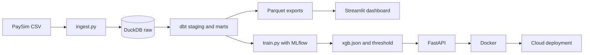

# Fintech Fraud Data Platform

An end-to-end fraud analytics platform built on the PaySim mobile-money
simulation: idempotent ingestion, DuckDB, dbt, business analysis, machine
learning, FastAPI, Streamlit, and Docker.

Public API and dashboard URLs: not deployed yet.

## Architecture



## Results

| Model | PR-AUC (test) |
|---|---:|
| Isolation Forest | 0.5741 |
| Logistic Regression | 0.9702 |
| XGBoost | 0.9952 |

At the validation-chosen threshold, precision was 0.9253 and recall was
0.9971. Simulated cost was 406,405.0800 with the model versus
2,340,743,287.2300 with no model.

Assumptions: each flagged transaction costs 5 for manual review; missed fraud
costs its transaction amount.

## Business findings

See [docs/findings.md](docs/findings.md) for the four measured recommendations.

## Leakage

Post-transaction balances increased XGBoost PR-AUC from 0.9952 to 0.9960, but
they were excluded because they are unavailable when a transaction must be
approved. Full results are in [docs/results.md](docs/results.md).

## Data quality

dbt runs 13 automated tests on every build, including uniqueness, null checks,
negative amounts, valid transaction types, and fraud outside TRANSFER and
CASH_OUT.

## How to run

1. Download PaySim from Kaggle and save it as `data/raw/paysim.csv`.
2. Create and activate a Python 3.12 virtual environment.
3. Install dependencies:
   ```bash
   pip install -r requirements-dev.txt
   ```
4. Rebuild ingestion, dbt models, and dashboard exports:
   ```bash
   python src/run_pipeline.py
   ```
   The runner will reach training once `src/train.py` is available.
5. Start the local services:
   ```bash
   docker compose up -d --build
   ```
   The API is at `http://localhost:8000/docs`; the dashboard is at
   `http://localhost:8501`.

## Known limitations

- PaySim is simulated, so scores overstate real-world performance.
- Feature logic exists in both SQL and Python, creating training-serving skew risk.
- The API requires `dest_prev_txn_count` from the caller; production would use a feature store.
- Free-tier services may sleep when idle.

## Screenshots

- [Dashboard](docs/screenshots/dashboard.png)

## Dataset citation

Lopez-Rojas, Elmir, Axelsson. *PaySim: A financial mobile money simulator for
fraud detection*. EMSS 2016.
